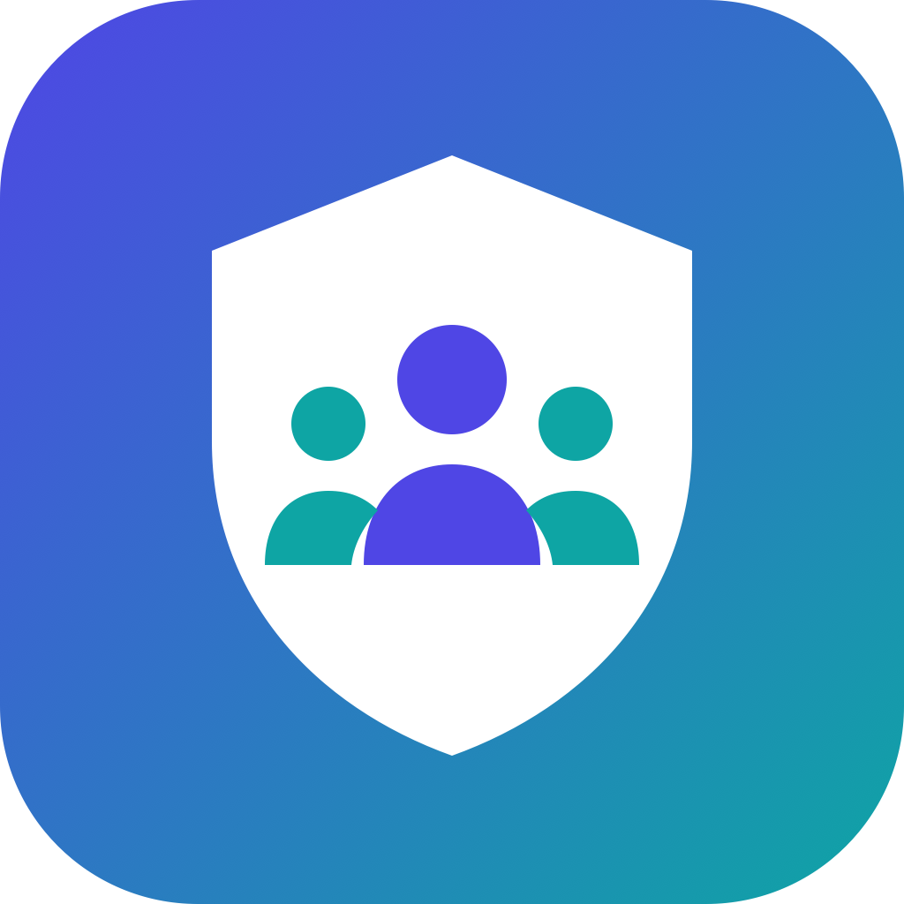

# Team Roles



Team Roles lets one person own a project and give every teammate's device a role, so Claude Code on that device changes only the files that role owns. It works with any language, framework or folder layout, because all paths live in the project's own `.claude/team-roles.json`, never in the plugin.

## Install

At the prompt of a Claude Code terminal session:

```
/plugin install team-roles --marketplace Mohiuddin655-PRO/claude-team-roles
```

From a shell:

```
claude plugin install team-roles --marketplace Mohiuddin655-PRO/claude-team-roles
```

A project can switch it on for every teammate in its `.claude/settings.json`:

```json
{
  "extraKnownMarketplaces": {
    "team-roles": { "source": { "source": "github", "repo": "Mohiuddin655-PRO/claude-team-roles" } }
  },
  "enabledPlugins": { "team-roles@team-roles": true }
}
```

It needs a recent Claude Code, as it runs on the plugin function-hooks API.

From a folder on this machine instead:

```
claude plugin marketplace add ~/DevTools/team-roles
claude plugin install team-roles@team-roles
```

## Set up a project

On the owner's device, tell Claude in plain words: "set up roles". Claude reads the project's folders, proposes `.claude/team-roles.json` and saves it only on "y". Then commit and push it; each teammate pulls.

Give or take a role the same way: "give dev@example.com the logic role", "add src/shop/services/ to ui@example.com", "remove qa@example.com". Only the owner's device can change the roles.

## How a device is known

By its git email (`git config user.email`). The owner changes everything. Everyone else changes only their role's `can` paths, plus any paths a permission note gives them. An email not in `members` gets the `default` role, or changes nothing when there is no default.

## Roles

The owner changes everything. The built-in roles, whose rules come with the plugin:

- **designer**: every visible part, with demo data and demo services only.
- **coder**: any code that changes nothing users see; visible changes only by a note with `Visible: yes`.
- **tester**: tests everything and reports; changes nothing else unless a note gives it.
- **backend**: backend work only.
- **analytics**: analytics code anywhere, nothing else.
- **publisher**: store and release work.
- **lawyer**: terms, policy, payment terms, government data rules, licences.

Which paths each may change is the project's own. A project may add roles of its own, each with an `about` line.

## Rules

Every project gets the plugin's working rules: ask before serious steps, short answers, "<what>, y/n?" questions, cleanup, and git rules (commit and push only when agreed). A project adds its own in `rules` (one file or a list, such as `CLAUDE.md` or `docs/RULES.md`); the plugin reads them to Claude on every request, they win where they differ, and only the owner changes them.

## The config

See [examples/team-roles.json](examples/team-roles.json).

- `can` paths are globs from the repository's root: `*` is one folder level, `**` any depth, a trailing `/` the folder and everything under it, `!` in front takes a path back out. As in `.gitignore`, the last line that matches decides.
- `{ "path": "...", "if": "regex", "unless": "regex" }` allows an edit only when its text matches `if`, and not when it matches `unless`.
- `ownerOnly` lists more files only the owner changes. `.claude/team-roles.json` and `.claude/settings*.json` are always the owner's.

## Permission notes

To let someone do part of your work, say on your device "handover this task to dev@example.com". Claude confirms, then commits a note in the `notes` folder:

```
To: dev@example.com
Can: src/shop/services/, the refund flow
Visible: yes
```

`Visible: yes` lets a coder change what users see, in those paths only.

A note counts only once committed, only from devices that may change those paths themselves, and never opens owner-only files. Delete the note to take the permission back.

## Limits

Team Roles guides and guards Claude Code. It does not stop someone editing files by hand, and a git email can be changed. For hard enforcement, add branch protection and a `CODEOWNERS` file on your git host.
